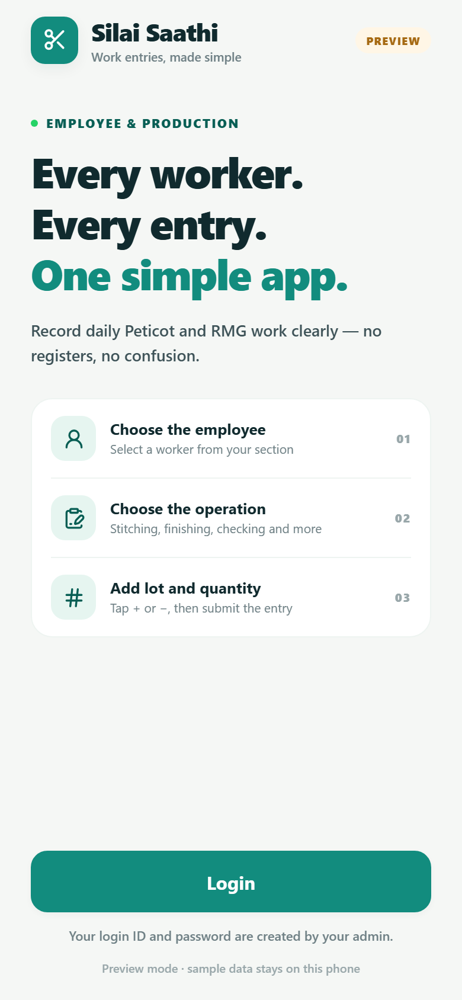

# Silai Saathi

A simple employee and production management app for a small cloth-manufacturing
factory. Silai Saathi gives Petticoat and RMG managers one familiar place to record
daily stitching work, and gives the admin one place to manage people, operations,
and production entries.

The interface is intentionally calm and WhatsApp-like: large touch targets,
short forms, clear section colours, and no unnecessary settings.



## What the app does

### Manager flow

1. Open the app and tap **Login**.
2. Choose **Petticoat** or **RMG**.
3. Sign in with the login ID and password created by the admin.
4. Petticoat managers use the guided lot workflow. Start a lot in **Cutting**
   with employee, meter, area, width, panel, remarks, lot number, and quantity.
   Continue the same lot through Interlock, Kamarpatti/Bottom/Dori/Nada in any
   order, Dhoka, and Folding. The quantity carries automatically.
5. RMG managers use **Add work**: choose an employee, operation, lot number,
   and quantity.
6. Review today's entries, seven-day history, or all entries in **History**.
7. View login details and log out from **Account**.

Managers only see employees and operations from their own section. Each
manager's history shows only the entries they submitted.

### Admin flow

The admin can:

- See active manager, employee, and operation counts.
- See today's entry and piece totals plus recent production.
- Create manager logins with a name, login ID, password, and Petticoat/RMG
  designation.
- Add employees to the Petticoat or RMG section.
- Create and disable operations.
- Search managers and employees, and permanently delete records that have no
  production entries.
- View all production entries with section filters.
- Generate an Excel-compatible CSV for one completed 31-day period, then
  download it or share/send it through WhatsApp or email.
- Manage the admin account and log out from **Setup**.

Disabled accounts stay in the database so historical work entries remain
intact, but they cannot sign in or appear in manager dropdowns.

## Tech stack

| Part | Technology |
| --- | --- |
| Mobile app | Expo SDK 57, React Native 0.86, React Navigation 7, TypeScript |
| Icons | lucide-react-native |
| API | Node.js 20+, Express 5, TypeScript |
| Database | Supabase PostgreSQL |
| Authentication | bcrypt password hashes + JWT bearer tokens |
| Device session storage | Expo AsyncStorage |

The mobile app **never** connects directly to Supabase. All reads and writes go
through the Express API. Supabase Row Level Security is enabled on every table
with no public policies, so the anon and authenticated Supabase keys cannot read
or write the app tables directly. The API connects as the table owner.

```
Expo app  ──HTTPS/HTTP──>  Express API  ──PostgreSQL──>  Supabase
   │                         │
   └── stores only the JWT    └── bcrypt + JWT + validation
```

## Project structure

```text
Employee-Management/
├── mobile/                       Expo React Native app
│   ├── src/
│   │   ├── components/           Reusable UI pieces
│   │   ├── constants/            Theme, app config, version
│   │   ├── context/              Authentication and toast providers
│   │   ├── navigation/           Auth, manager, admin navigators
│   │   ├── screens/              All app screens
│   │   ├── services/             Preview store and live API client
│   │   └── utils/                Formatting helpers
│   ├── assets/                   App icon and splash assets
│   ├── app.config.ts             Expo app configuration
│   └── eas.json                  Android preview/production profiles
│
├── backend/                      Express + PostgreSQL API (TypeScript)
│   ├── README.md                 Backend-only VPS deployment guide
│   ├── ecosystem.config.cjs      PM2 production process configuration
│   ├── deploy/nginx.conf.example Reverse-proxy example
│   ├── src/server.ts             API entry point and startup logging
│   ├── src/app.ts                Express middleware and route wiring
│   ├── src/scripts/setup-db.ts   Applies schema, seeds admin and operations
│   ├── src/routes/               auth, admin, manager endpoints
│   ├── src/middleware/           JWT authentication and role checks
│   ├── src/types.ts              Shared API and database types
│   ├── supabase/schema.sql       Tables, constraints, indexes, RLS
│   ├── supabase/seed.sql         Admin, managers, employees, operations
│   ├── tsconfig.json             TypeScript compiler configuration
│   └── dist/                     Compiled JavaScript (generated by build)
│
├── docs/SETUP.md                 Detailed Supabase and deployment guide
└── package.json                  Convenience scripts for both apps
```

## Try it now in preview mode

Preview mode needs no Supabase project and no backend. Data is stored locally on
the phone with AsyncStorage. It is meant for trying the interface and for UI
development; release builds always use the Express API.

### 1. Install dependencies

```powershell
npm install
npm --prefix mobile install
npm --prefix backend install
```

### 2. Start Expo

```powershell
npm run start
```

Then open the QR code with **Expo Go** on a phone connected to the same Wi-Fi.
You can also run the web preview:

```powershell
npm run web
```

If Expo starts on a different port, use the URL printed in the terminal.

### 3. Sign in with a preview account

| Role | Login ID | Password |
| --- | --- | --- |
| Admin | `admin` | `Admin@123` |
| Petticoat manager | `petticoat` | `Petticoat@123` |
| RMG manager | `rmg` | `Rmg@123` |

The same credentials are shown on the login screens while the app is in preview
mode. Preview passwords are stored locally in plain text for convenience. Do not
enter real passwords in preview mode.

> Restart Expo with `npx expo start -c` after changing `.env`. To reset preview
> data, clear the app's storage (or clear the browser site data for the web
> preview).

## Connect the real Supabase database

Once the preview is working, follow [docs/SETUP.md](docs/SETUP.md). The short
version is:

```powershell
# 1. Create backend/.env from backend/.env.example and fill in DATABASE_URL,
#    JWT_SECRET, ADMIN_USERNAME, and ADMIN_PASSWORD.
Copy-Item backend\.env.example backend\.env

# 2. Apply the schema and seed the first admin + starter operations.
npm run db:setup

# 3. Start the API.
npm run backend

# 4. Create mobile/.env and point the app at the computer's LAN IP.
Copy-Item mobile\.env.example mobile\.env
# EXPO_PUBLIC_API_URL=http://192.168.1.25:4000

# 5. Restart Expo.
npm run start
```

If you prefer the Supabase SQL Editor, run `backend/supabase/schema.sql` first,
then `backend/supabase/seed.sql`. The seed creates the admin, 10 managers,
20 employees, and seven operations in each section (Kamarpatti, Interlock,
Bottom, Dhoka, Folding, Dori, and Nada); you can skip step 2 but still need
`DATABASE_URL` in `backend/.env`.

The `backend` folder is self-contained and can be deployed to a VPS by itself.
See [backend/README.md](backend/README.md) for the Node.js, PM2, Nginx, and
HTTPS deployment guide. The mobile app and repository root are not required on
the server.

If `EXPO_PUBLIC_API_URL` is missing or empty, development builds run in preview
mode. Release builds never use preview data; set the URL in the build
environment before creating an APK or AAB.

The backend prints the addresses a phone can use when it starts:

```text
Silai Saathi API listening on http://localhost:4000
Phone on the same Wi-Fi: http://192.168.1.25:4000
```

Use the **Phone on the same Wi-Fi** address in `mobile/.env`, not `localhost`.

## Useful commands

Run these from the repository root unless noted otherwise.

| Command | What it does |
| --- | --- |
| `npm run start` | Start the Expo dev server |
| `npm run web` | Start the Expo web preview |
| `npm run android` | Start Expo and open Android |
| `npm run typecheck` | Type-check the mobile app |
| `npm run check` | Type-check the mobile app and backend |
| `npm run backend` | Start the API in TypeScript watch mode |
| `npm run backend:build` | Compile the backend to `backend/dist` |
| `npm run backend:start` | Compile and start the API normally |
| `npm run db:setup` | Apply schema + seed first admin/operations |

Mobile-only checks:

```powershell
cd mobile
npx expo-doctor
npx expo install --check
npx expo export --platform android
```

Backend type check:

```powershell
npm --prefix backend run check
```

## API overview

All routes return JSON. Except for login, every request needs
`Authorization: Bearer <token>`.

| Method | Route | Who | Purpose |
| --- | --- | --- | --- |
| `GET` | `/health` | Public | API/database health |
| `POST` | `/auth/admin/login` | Public | Admin login |
| `POST` | `/auth/manager/login` | Public | Manager login, with section |
| `GET` | `/auth/me` | Signed in | Restore the current session |
| `GET` | `/manager/home` | Manager | Dropdown data, recent entries, today totals |
| `GET` | `/manager/entries` | Manager | Manager's own entry history |
| `POST` | `/manager/entries` | Manager | Submit a work entry |
| `GET` | `/admin/dashboard` | Admin | Counts and recent entries |
| `GET/POST/PATCH` | `/admin/managers` | Admin | List, create, update managers |
| `GET/POST/PATCH` | `/admin/employees` | Admin | List, create, update employees |
| `GET/POST/PATCH` | `/admin/operations` | Admin | List, create, update operations |
| `GET` | `/admin/entries` | Admin | All production entries |

## Validation and safety notes

- Passwords are hashed with bcrypt before being stored in Supabase.
- JWT secrets must be at least 32 characters; the API refuses to start
  otherwise.
- Login routes are rate-limited. The whole API also has a general request limit.
- The API re-checks the authenticated account against the database on each
  request, so disabling an account takes effect immediately.
- The manager API verifies that the selected employee and operation belong to
  the manager's section.
- The API validates lot numbers, quantities, names, usernames, departments, and
  IDs before writing.
- RLS is enabled on all Supabase tables with no public policies.
- Preview mode is local-only and is **not** a production authentication system.

## Production checklist

- [ ] Change the default admin password before deployment.
- [ ] Use a strong, unique `JWT_SECRET` and do not commit `.env`.
- [ ] Set `NODE_ENV=production` and a specific `CORS_ORIGIN` if web clients are used.
- [ ] Put the API behind HTTPS (for example, a reverse proxy with a TLS
  certificate).
- [ ] Enable strict database certificate checking with `DATABASE_SSL_STRICT=true`
  and `DATABASE_CA` when available.
- [ ] Configure Supabase backups and monitor database usage.
- [ ] Build and distribute the Android app with EAS.
- [ ] Keep Supabase service-role keys on the backend only; never ship them in the
  mobile app.

See [docs/SETUP.md](docs/SETUP.md) for the complete setup, Expo Go, deployment,
and troubleshooting walkthrough.
